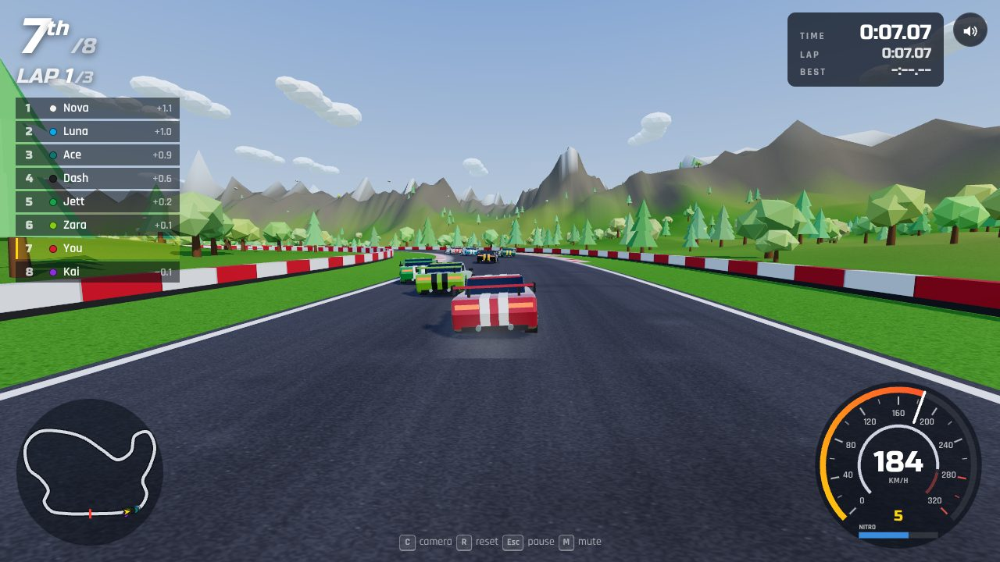
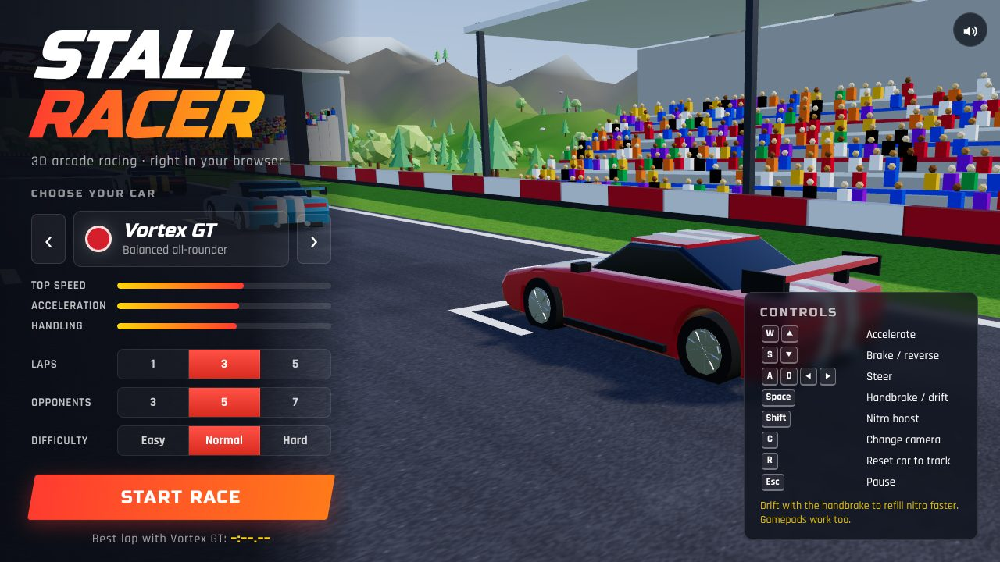

# Stall Racer · 3D car racing in the browser

A complete 3D arcade racing game built with [Three.js](https://threejs.org/) and [Vite](https://vite.dev/).
Race up to seven AI opponents around a 2 km circuit with elevation changes, drift through the
corners to charge your nitro, and chase your best lap time. It runs in any modern browser on
desktop or mobile.



## Features

- **Procedural 3D world.** The circuit, terrain, trees, grandstands with a cheering crowd,
  start gantry, cars, sky and textures are all generated in code. There are no model or image
  files.
- **Arcade car physics.** Steering gets less sharp as speed rises, tyres lose grip and slide,
  the handbrake drifts the car, the gearbox shifts automatically, cars climb and roll with the
  hills, and they bounce off barriers and each other.
- **Three cars with different handling:**
  - *Vortex GT*: balanced
  - *Phantom R*: highest top speed
  - *Viper S*: most grip and fastest acceleration
- **AI opponents.** They follow a racing line, brake for corners, overtake, use nitro on the
  straights and recover after crashes. Choose Easy, Normal or Hard.
- **Full race flow.** A camera fly-in, a start-light countdown, lap timing, live positions and
  a results table. Your best laps are saved in your browser.
- **HUD:** position, lap counter, race/lap/best times, live standings, a speedometer with
  gear, rev counter and nitro gauge, and a minimap.
- **Synthesised audio** using the Web Audio API: the engine follows the revs, plus tyre
  screech, wind, curb rumble, off-road noise, crashes, countdown beeps and a nitro whoosh.
- **Effects:** tyre smoke, off-road dust, sparks, skid marks, nitro exhaust flames and camera
  shake.
- **Three camera views:** chase, far chase and hood.
- **Controls** for keyboard, gamepad and touch screens.



## Controls

| Action              | Keyboard            | Gamepad            | Touch        |
| ------------------- | ------------------- | ------------------ | ------------ |
| Accelerate          | `W` / `↑`           | RT                 | ▲ button     |
| Brake / reverse     | `S` / `↓`           | LT                 | ▼ button     |
| Steer               | `A` `D` / `←` `→`   | Left stick / D-pad | ◀ ▶ buttons  |
| Handbrake / drift   | `Space`             | A / RB             | DRIFT        |
| Nitro               | `Shift` (or `N`)    | X / B / LB         | NITRO        |
| Change camera       | `C`                 | Y                  | CAM          |
| Reset car to track  | `R`                 | Back               | –            |
| Pause               | `Esc` / `P`         | Start              | ❚❚           |
| Mute                | `M`                 | –                  | speaker icon |

**Tip:** drifting with the handbrake refills nitro much faster than waiting for it to recharge.

## Running locally

Requires Node.js 18 or newer.

```bash
npm install
npm run dev       # start the dev server at http://localhost:5173
npm run build     # build the production version into dist/
npm run preview   # serve the production build
```

The production build uses relative paths, so you can host the `dist/` folder from any static
web server (GitHub Pages, Netlify, itch.io, …).

## Project structure

```
index.html              UI screens: loading, menu, HUD, touch controls, pause, results
src/main.js             entry point (fonts, styles, touch detection, starts the game)
src/style.css           all UI styling, including mobile layouts
src/game/
  Game.js               renderer, game states, fixed 120 Hz physics loop, race events
  TrackData.js          circuit centre-line, elevation, track lookups, racing line, speed profile
  terrain.js            terrain height around the circuit
  TrackBuilder.js       road, curbs, barriers, start line, gantry, ad boards, terrain mesh
  Scenery.js            sky, lighting, trees, grandstands and crowd, clouds
  CarModel.js           procedural low-poly car (wheels steer and spin, brake lights, flames)
  Car.js                car physics and car-to-car collisions (no rendering code)
  AIDriver.js           AI driving
  Race.js               lap counting, timing, standings, results
  CameraRig.js          chase / hood / orbit cameras, FOV that widens with speed, shake
  AudioEngine.js        synthesised sound
  Effects.js            smoke, dust, sparks, skid marks
  HUD.js / UI.js        HUD drawing and menu / pause / results logic
  Input.js              keyboard, gamepad and touch input
  config.js             cars, difficulty settings, nitro tuning
  textures.js           textures drawn in code (asphalt, curbs, banners, grass…)
  batch.js              merges static scenery meshes to reduce draw calls
```

`Car.js`, `AIDriver.js`, `Race.js` and `TrackData.js` don't touch the browser, so the whole
race can be simulated in Node.js to tune handling and AI lap times.

## Credits

Code: this repository. Fonts: [Russo One](https://fonts.google.com/specimen/Russo+One) and
[Rajdhani](https://fonts.google.com/specimen/Rajdhani) (SIL Open Font License) via Fontsource.
